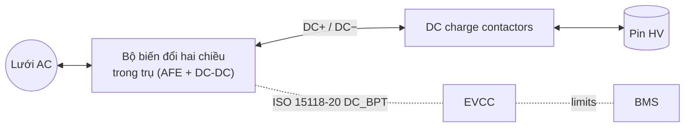
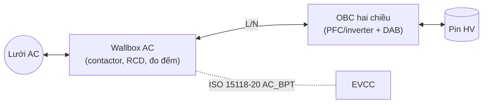

# AC vs DC V2G

## So sánh (Comparison)

| Tiêu chí | **DC V2G** | **AC V2G** |
|---|---|---|
| Bộ biến đổi DC↔AC | Trong **trụ** (off-board) | Trên **xe** (OBC hai chiều) |
| Chiều trên cáp | DC | AC |
| Ai chịu chứng nhận nối lưới? | Trụ sạc | **Xe** (xe trở thành nguồn phát – DER) |
| Chi phí trụ | Cao (bộ biến đổi hai chiều) | Thấp (wallbox AC thường + giao tiếp) |
| Chi phí xe | Thấp (dùng đường DC sẵn có) | Cao hơn (OBC hai chiều, phần mềm grid code) |
| Giao thức | ISO 15118-20 **DC_BPT**, CHAdeMO | ISO 15118-20 **AC_BPT** (+ Amd cho DER) |
| Công suất điển hình (dân dụng) | ~7 – 20 kW | ~7 – 11 kW |
| Mức sẵn sàng | Có sản phẩm thương mại (CHAdeMO lâu năm; CCS đang triển khai) | Đang chuẩn hóa và thí điểm |

## Chứng nhận nối lưới (Grid interconnection)

| Khu vực | Tiêu chuẩn / quy định tiêu biểu |
|---|---|
| Bắc Mỹ | IEEE 1547-2018, UL 1741 (SB), SAE J3072 (inverter trên xe), CA Rule 21 + IEEE 2030.5 |
| Châu Âu | EN 50549-1/-2, VDE-AR-N 4105 (Đức), G98/G99 (Anh) |
| Việt Nam | Theo quy định đấu nối của ngành điện; đối chiếu các thông tư hiện hành |

## Kiến trúc DC V2G (DC V2G architecture)

## Kiến trúc AC V2G (AC V2G architecture)

!!! note "Yêu cầu phía xe với AC V2G"
    Xe cần chức năng của inverter nối lưới: đồng bộ pha (PLL), chống đảo (*anti-islanding*), ride-through điện áp/tần số, đáp ứng công suất phản kháng, và cấu hình được theo grid code từng nước.
