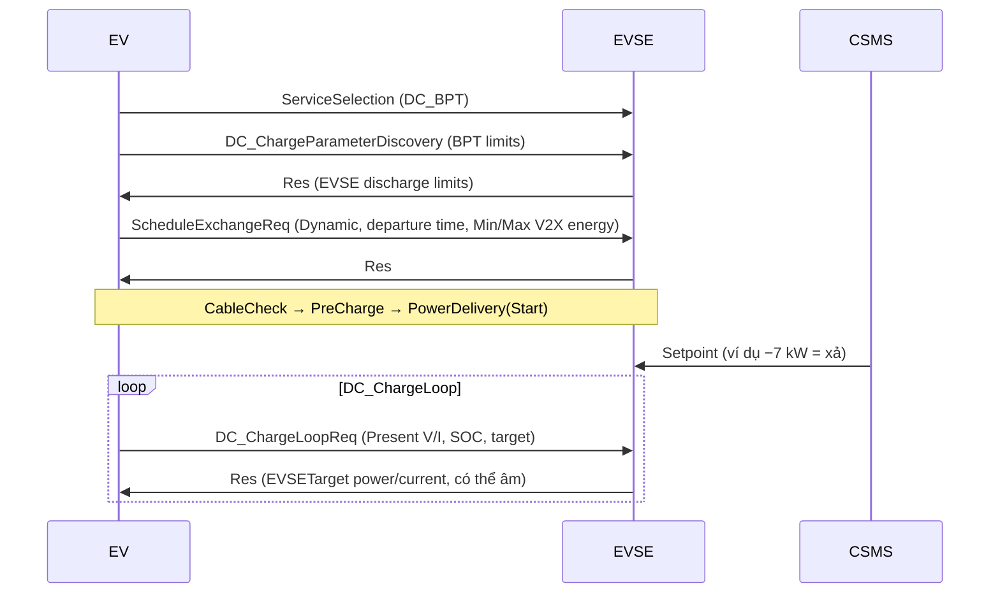

# Chuẩn giao tiếp V2G (V2G Communication Standards)

## Theo từng chặng (By link)

| Chặng | Chuẩn | Ghi chú |
|---|---|---|
| Xe ↔ Trụ (CCS, NACS) | **ISO 15118-20** (DC_BPT, AC_BPT) | Chuẩn chính cho V2G trên CCS/NACS |
| Xe ↔ Trụ (CHAdeMO) | **CHAdeMO 1.1+ / V2H guideline**, CHAdeMO 2.x | V2G/V2H thương mại lâu năm tại Nhật (ví dụ Nissan Leaf); CAN |
| Xe ↔ Trụ (GB/T) | Bộ GB/T 2023 / ChaoJi | Trung Quốc đang thí điểm V2G; đối chiếu văn bản mới nhất |
| Trụ ↔ Backend | **OCPP 2.0.1** (hỗ trợ ISO 15118, smart charging), **OCPP 2.1** (bổ sung V2X/hai chiều, điều khiển DER) | OCPP 2.1 do OCA phát hành đầu 2025 |
| Backend ↔ Lưới / Aggregator | **IEEE 2030.5** (SEP 2.0), **OpenADR 2.0/3.0**, IEC 61850 | IEEE 2030.5 bắt buộc theo CA Rule 21 cho DER thông minh |
| Xe ↔ Backend OEM | API riêng của OEM | Điều phối qua cloud của hãng |

## ISO 15118-20 – luồng V2G DC (Dynamic mode)

## CHAdeMO V2G (tham khảo)

- Dùng **CAN** trên chân riêng; trụ đọc thông số xe và điều khiển dòng theo cả hai chiều.
- Hướng dẫn V2H của CHAdeMO (*V2H guideline*) hình thành từ các dự án sau động đất Nhật 2011; là hệ sinh thái V2H/V2G trưởng thành nhất hiện nay.

## Gợi ý lộ trình cho OEM (Suggested roadmap)

1. **V2L** qua OBC hai chiều hoặc inverter riêng (không cần giao tiếp với lưới).
2. **DC V2H/V2G** qua ISO 15118-20 DC_BPT với trụ hai chiều đã chứng nhận.
3. **AC V2G** khi quy định grid code và ISO 15118-20 (sửa đổi AC/DER) đã ổn định ở thị trường mục tiêu.
4. Tích hợp backend: OCPP 2.1 + cổng lưới (IEEE 2030.5 / OpenADR).
