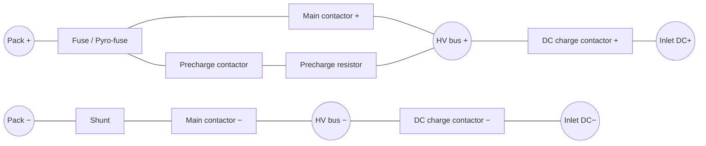

# Contactor & Precharge

## Cấu trúc BDU điển hình (Typical BDU)

## Vì sao cần precharge? (Why precharge?)

Phía tải có tụ DC-link lớn (inverter, DC-DC, OBC: hàng trăm µF đến vài mF). Đóng thẳng contactor vào tụ đang ở 0 V sẽ gây **dòng xung (inrush)** rất lớn → hàn dính tiếp điểm, hỏng tụ, nhảy cầu chì.

Dòng ban đầu qua điện trở precharge:

\[
I_0 = \frac{U_{pack}}{R_{pc}}, \qquad U_C(t) = U_{pack}\left(1 - e^{-t/(R_{pc} C)}\right)
\]

Thời gian đạt 95 % ≈ \(3RC\). Ví dụ: \(R = 50\ \Omega\), \(C = 1\ \text{mF}\) → \(\tau = 50\ \text{ms}\), 95 % sau ~150 ms.

## Trình tự đóng (Closing sequence)

1. Kiểm tra trạng thái contactor (phải mở), kiểm tra HVIL và cách điện.
2. Đóng **main contactor −**.
3. Đóng **precharge contactor** → điện áp bus tăng theo RC.
4. Khi \(U_{bus} \geq\) ~90 – 98 % \(U_{pack}\) (tùy OEM) trong thời gian cho phép → đóng **main contactor +**.
5. Mở precharge contactor.
6. Lỗi nếu quá thời gian (*precharge timeout*): thường do ngắn mạch phía tải, tụ hỏng, điện trở precharge hở hoặc quá nhiệt.

## Contactor sạc DC (DC charge contactors)

- Chỉ đóng sau khi trụ đã **pre-charge** điện áp đầu ra cáp gần bằng điện áp pack (DIN 70121 / ISO 15118: chênh lệch thường yêu cầu trong khoảng ±20 V hoặc theo giới hạn OEM).
- Mở khi dòng đã giảm về gần 0 (trụ nhận lệnh dừng và giảm dòng trước). Cắt dưới tải làm mòn tiếp điểm.

## Phát hiện hàn dính (Welding detection)

| Phương pháp | Mô tả |
|---|---|
| Đo áp hai phía | Mở contactor rồi đo điện áp phía inlet/bus; nếu vẫn bằng áp pack → hàn dính |
| *WeldingDetection* (CCS) | Sau khi dừng, xe gửi *WeldingDetectionReq*, trụ báo điện áp đầu ra để xe xác nhận đã mở |
| Phản hồi tiếp điểm phụ | Contactor có *auxiliary contact* báo trạng thái |

!!! danger "An toàn"
    Contactor hàn dính ở mạch DC sạc có thể để **điện áp pack xuất hiện trên chân inlet** khi đã rút súng. Đây là lỗi nghiêm trọng, phải khóa sạc và báo lỗi.
