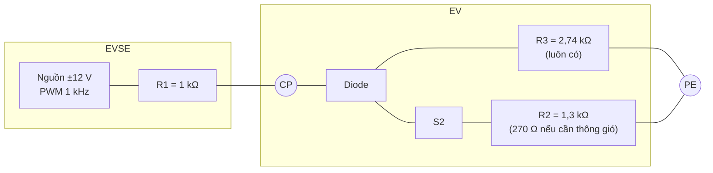
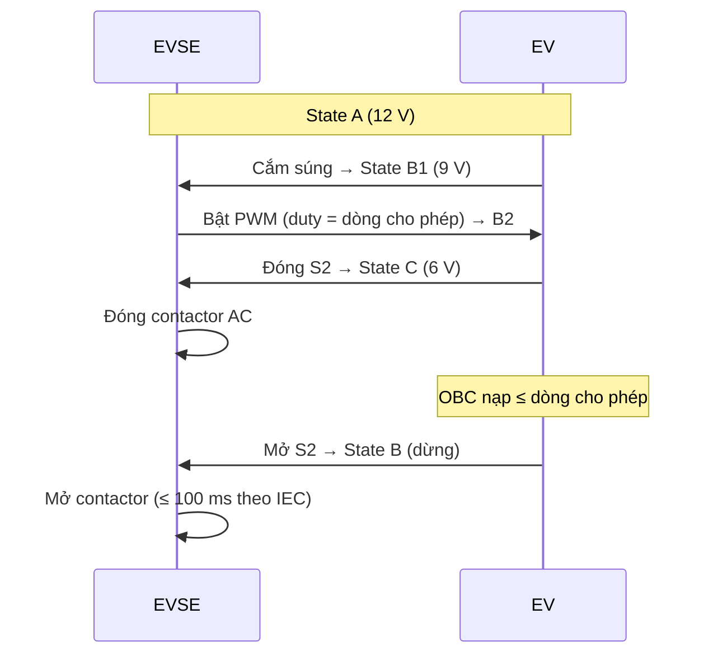

# Control Pilot (CP)

CP là tín hiệu an toàn và điều khiển cơ bản giữa trụ và xe, định nghĩa trong **IEC 61851-1 Annex A** và **SAE J1772** (dùng chung cho Type 1, Type 2, CCS1, CCS2, NACS). GB/T dùng mạch CP tương tự cho sạc AC.

## Mạch tương đương (Equivalent circuit)

- **Diode** phía xe: điện áp âm luôn ≈ −12 V → trụ dùng để phát hiện ngắn mạch CP–PE và xác nhận có xe hợp lệ.
- **S2** đóng khi xe sẵn sàng nhận điện.

## Trạng thái CP (CP states)

| Trạng thái | Điện áp đỉnh dương | Ý nghĩa | Điện trở phía xe |
|---|---|---|---|
| **A** | +12 V | Chưa cắm xe | ∞ |
| **B** | +9 V | Đã cắm, xe chưa sẵn sàng | 2,74 kΩ |
| **C** | +6 V | Xe sẵn sàng, yêu cầu điện | 2,74 kΩ ∥ 1,3 kΩ ≈ 882 Ω |
| **D** | +3 V | Sẵn sàng, **cần thông gió** (pin thải khí) | 2,74 kΩ ∥ 270 Ω ≈ 246 Ω |
| **E** | 0 V | Ngắn mạch CP–PE / trụ mất nguồn | — |
| **F** | −12 V | Trụ báo lỗi / không khả dụng | — |

Dung sai điển hình ±1 V. Ký hiệu **B1/C1** = không có PWM (trụ chưa cho phép), **B2/C2** = có PWM.

## Mã hóa dòng bằng duty cycle (Current via duty cycle)

Tần số 1 kHz. Trụ báo dòng AC lớn nhất xe được phép lấy:

| Duty cycle \(D\) | Ý nghĩa |
|---|---|
| **5 %** | Bắt buộc giao tiếp số (HLC: DIN 70121 / ISO 15118) – dùng cho sạc DC và AC có HLC |
| < 8 % (trừ 5 %) | Không cho phép sạc |
| 8 % – 10 % | 6 A |
| 10 % – 85 % | \(I = D[\%] \times 0{,}6\) A |
| 85 % – 96 % | \(I = (D[\%] - 64) \times 2{,}5\) A |
| 96 % – 97 % | 80 A |
| > 97 % | Không cho phép |

**Ví dụ:** 16 A ↔ 26,7 %; 32 A ↔ 53,3 %; 48 A ↔ 80 %; 80 A ↔ 96 %.

## Trình tự sạc AC cơ bản (Basic AC sequence)

!!! note "Thời gian phản ứng"
    IEC 61851-1 quy định giới hạn thời gian cho các phản ứng (ví dụ xe phải giảm dòng trong vài giây khi duty cycle giảm; trụ phải mở contactor nhanh khi CP rời trạng thái C). Đối chiếu bảng thời gian trong tiêu chuẩn cho giá trị chính xác.
