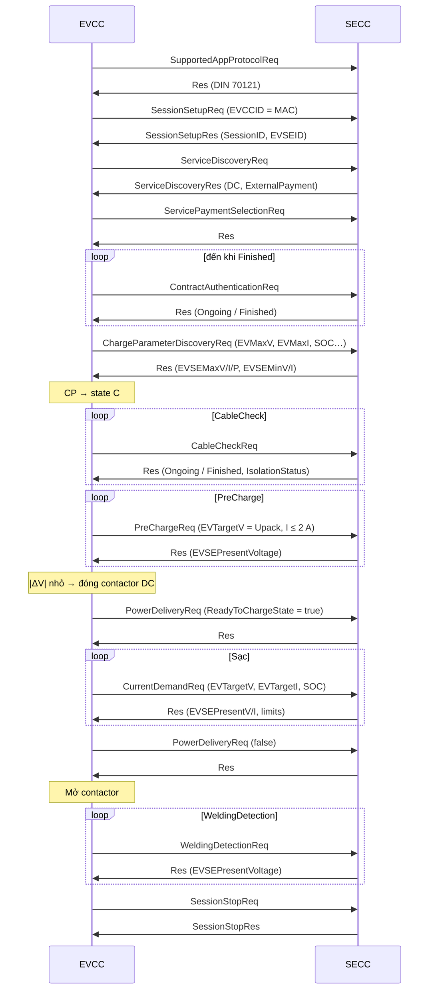

# DIN SPEC 70121

## Tổng quan (Overview)

- Giao thức sạc **DC** đầu tiên cho CCS, ban hành 2012 (sửa đổi 2014), dựa trên bản nháp ISO 15118-2.
- Không hỗ trợ AC HLC, không TLS, không Plug & Charge, không V2G.
- Vẫn được **hầu hết trụ DC** hỗ trợ → phương án dự phòng bắt buộc cho xe CCS / NACS.

## Trình tự bản tin (Message sequence)

## Tham số thời gian quan trọng (Key timing – tham khảo)

| Tham số | Giá trị điển hình |
|---|---|
| Thời gian tối đa của toàn bộ chuỗi trước khi sạc | ~60 s (*sequence timeout*) |
| Timeout chung cho mỗi bản tin (EVCC chờ Res) | ~2 s |
| CableCheck tổng | ~40 s |
| PreCharge tổng | ~7 s |
| Chu kỳ CurrentDemand | hàng chục đến vài trăm ms |

!!! warning "Đối chiếu"
    Giá trị thời gian chính xác nằm trong bảng *timing* của DIN SPEC 70121 và có thể bị OEM/trụ siết chặt hơn. Kiểm thử tương thích (*interoperability test*) thường phát hiện lỗi do vi phạm thời gian.

## Mã lỗi xe (DC_EVErrorCodeType – trích)

| Mã | Ý nghĩa |
|---|---|
| NO_ERROR | Không lỗi |
| FAILED_RESSTemperatureInhibit | Nhiệt độ pin không cho phép |
| FAILED_EVShiftPosition | Cần số không ở P |
| FAILED_ChargerConnectorLockFault | Lỗi khóa súng |
| FAILED_EVRESSMalfunction | Lỗi hệ pin |
| FAILED_ChargingCurrentdifferential | Dòng thực tế lệch dòng yêu cầu |
| FAILED_ChargingVoltageOutOfRange | Điện áp ngoài dải |
| FAILED_ChargingSystemIncompatibility | Không tương thích |
