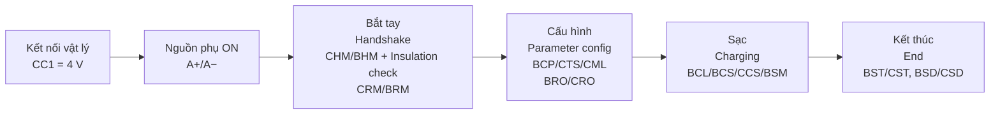

# GB/T 27930 (CAN)

## Lớp vật lý & khung (Physical & framing)

- **CAN 2.0B**, 29-bit extended ID, **250 kbit/s**, trên chân **S+ / S−** của đầu DC GB/T.
- Định dạng theo kiểu **SAE J1939**: ID = Priority | PGN | Destination | Source.
- Địa chỉ: **trụ (charger) = 0x56**, **BMS = 0xF4**.
- Bản tin dài hơn 8 byte (ví dụ BRM, BCP, BCS) dùng **J1939 Transport Protocol** (TP.CM / TP.DT, PGN 0xEC00 / 0xEB00).

**Ví dụ ID:** CHM (priority 6, PGN 0x2600, trụ → BMS) = `0x1826F456`; BHM (BMS → trụ) = `0x182756F4`.

## Các pha sạc (Charging phases)

## Bảng bản tin (Message table – bản 2015)

| Bản tin | PGN (hex) | Hướng | Nội dung |
|---|---|---|---|
| **CHM** | 0x2600 | Trụ → BMS | Bắt tay, phiên bản giao thức (ví dụ 1.1) |
| **BHM** | 0x2700 | BMS → Trụ | Điện áp sạc tổng tối đa cho phép (dùng cho kiểm tra cách điện) |
| **CRM** | 0x0100 | Trụ → BMS | Nhận dạng trụ; `0x00` = chưa nhận dạng BMS, `0xAA` = đã nhận dạng |
| **BRM** | 0x0200 | BMS → Trụ | Nhận dạng BMS: phiên bản, loại pin, dung lượng, điện áp định mức, VIN… |
| **BCP** | 0x0600 | BMS → Trụ | Tham số sạc: áp cell max, dòng max, năng lượng, áp tổng max, nhiệt max, SOC, điện áp hiện tại |
| **CTS** | 0x0700 | Trụ → BMS | Đồng bộ thời gian |
| **CML** | 0x0800 | Trụ → BMS | Điện áp/dòng đầu ra tối đa/tối thiểu của trụ |
| **BRO** | 0x0900 | BMS → Trụ | BMS sẵn sàng (`0xAA`) / chưa (`0x00`) |
| **CRO** | 0x0A00 | Trụ → BMS | Trụ sẵn sàng (`0xAA`) / chưa (`0x00`) |
| **BCL** | 0x1000 | BMS → Trụ | Yêu cầu sạc: điện áp, dòng, chế độ (CV / CC) |
| **BCS** | 0x1100 | BMS → Trụ | Trạng thái: áp/dòng đo, cell cao nhất, SOC, thời gian còn lại |
| **CCS** | 0x1200 | Trụ → BMS | Trạng thái trụ: áp/dòng đầu ra, thời gian sạc, cho phép sạc |
| **BSM** | 0x1300 | BMS → Trụ | Trạng thái pin: nhiệt độ, cảnh báo, cho phép sạc |
| BMV / BMT / BSP | 0x1500 / 0x1600 / 0x1700 | BMS → Trụ | Điện áp cell / nhiệt độ / dự phòng (tùy chọn) |
| **BST** | 0x1900 | BMS → Trụ | BMS dừng sạc + nguyên nhân |
| **CST** | 0x1A00 | Trụ → BMS | Trụ dừng sạc + nguyên nhân |
| **BSD** | 0x1C00 | BMS → Trụ | Thống kê BMS cuối phiên |
| **CSD** | 0x1D00 | Trụ → BMS | Thống kê trụ cuối phiên (năng lượng, thời gian) |
| **BEM** | 0x1E00 | BMS → Trụ | Lỗi BMS (timeout nhận bản tin trụ) |
| **CEM** | 0x1F00 | Trụ → BMS | Lỗi trụ (timeout nhận bản tin BMS) |

!!! note "Lưu ý tên gọi"
    Bản tin **CCS** trong GB/T là *Charger Charging Status*, không liên quan đến chuẩn **CCS** (*Combined Charging System*).

## Kiểm tra cách điện trong GB/T (Insulation check)

Sau CHM/BHM, trụ đóng contactor đầu ra (contactor phía xe vẫn mở), nâng điện áp đến **min(điện áp tối đa BHM, điện áp tối đa của trụ)**, đo cách điện, sau đó xả bằng mạch xả trước khi chuyển sang CRM.

## Timeout & lỗi (Timeouts & errors)

- Mỗi bản tin có chu kỳ gửi (ví dụ 10 ms, 50 ms, 250 ms) và timeout (thường 5 s cho bản tin chính).
- Khi hết thời gian chờ, bên nhận gửi **BEM/CEM** với bit chỉ ra bản tin bị timeout; trụ có thể thử lại bắt tay (giới hạn số lần).

## GB/T 27930-2023

Bản 2023 (áp dụng từ 04/2024) được phát triển cùng GB/T 18487.1-2023 và GB/T 20234.4-2023, là phần giao tiếp của hệ thống **ChaoJi** và hỗ trợ sạc công suất lớn. Khi phát triển sản phẩm mới cho thị trường Trung Quốc, đối chiếu bản 2023 cho tương thích ngược với trụ 2015.
