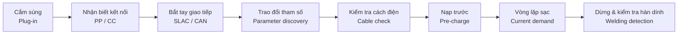

EV High-Voltage & Charging Handbook

# Sổ tay HV & Sạc xe điện

Tài liệu tra cứu song ngữ Việt–Anh dành cho kỹ sư: hệ thống cao áp, chuẩn sạc CCS1 / CCS2 / GB/T / NACS, giao tiếp DIN 70121 – ISO 15118 – GB/T 27930 và V2G.

[Bắt đầu đọc :material-arrow-right:](hv/index.md){ .md-button .md-button--primary }
[So sánh các chuẩn :material-table:](chuan/so-sanh.md){ .md-button }

CCS2CCS1GB/TNACS · SAE J3400ISO 15118-20V2G

## Các chương

-   :material-battery-charging-high:{ .lg } **1. Hệ thống HV**

    ---

    Kiến trúc 400 V / 800 V, pin & BMS, contactor, precharge, HVIL, cách điện, OBC, DC-DC.

    [:material-arrow-right: Xem chương](hv/index.md)

-   :material-sine-wave:{ .lg } **2. Cơ bản về sạc**

    ---

    Chế độ sạc IEC 61851, tín hiệu Control Pilot (PWM, trạng thái A–F) và Proximity Pilot.

    [:material-arrow-right: Xem chương](sac-co-ban/index.md)

-   :material-ev-plug-ccs2:{ .lg } **3. Chuẩn đầu nối**

    ---

    Sơ đồ chân, định mức và đặc điểm CCS2, CCS1, GB/T, NACS – kèm bảng so sánh.

    [:material-arrow-right: Xem chương](chuan/index.md)

-   :material-lan-connect:{ .lg } **4. Giao tiếp**

    ---

    PLC & SLAC, DIN SPEC 70121, ISO 15118-2 / -20, GB/T 27930 (CAN), Plug & Charge.

    [:material-arrow-right: Xem chương](giao-tiep/index.md)

-   :material-transmission-tower-export:{ .lg } **5. V2G**

    ---

    V2L / V2H / V2B / V2G, AC so với DC V2G, ISO 15118-20 BPT, OCPP 2.1, IEEE 2030.5.

    [:material-arrow-right: Xem chương](v2g/index.md)

-   :material-stethoscope:{ .lg } **6. Chẩn đoán lỗi**

    ---

    Khoanh vùng lỗi theo từng pha của phiên sạc, bảng lỗi thường gặp, công cụ đo.

    [:material-arrow-right: Xem chương](chan-doan/index.md)

## Tra cứu nhanh

[:material-pulse: Duty cycle ↔ dòng](sac-co-ban/control-pilot.md#ma-hoa-dong-bang-duty-cycle-current-via-duty-cycle)
[:material-resistor: Điện trở PP](sac-co-ban/proximity-pilot.md)
[:material-pin: Sơ đồ chân CCS2](chuan/ccs2.md#so-o-chan-pinout)
[:material-pin: Sơ đồ chân GB/T](chuan/gbt.md)
[:material-swap-horizontal: Trình tự DIN 70121](giao-tiep/din70121.md)
[:material-format-list-numbered: Bảng PGN GB/T 27930](giao-tiep/gbt27930.md)
[:material-shield-key: Plug & Charge PKI](giao-tiep/plug-and-charge.md)
[:material-translate: Thuật ngữ Anh–Việt](phu-luc/thuat-ngu.md)

## Phiên sạc DC nhìn từ trên xuống

Mỗi chuẩn đều đi qua các bước tương tự; khác nhau chủ yếu ở **đường truyền tín hiệu** (PLC trên CP hay CAN riêng) và **tên bản tin**.

!!! warning "Lưu ý / Notice"
    Các giá trị trong sổ tay là **giá trị tham khảo**. Luôn đối chiếu **bản tiêu chuẩn gốc có hiệu lực** (IEC, ISO, SAE, GB/T, DIN) và yêu cầu nội bộ trước khi dùng cho thiết kế, kiểm định hoặc chứng nhận.

**Mẹo:** nhấn ++slash++ để tìm kiếm · rê chuột lên từ viết tắt (HV, SLAC, EVSE…) để xem nghĩa.
