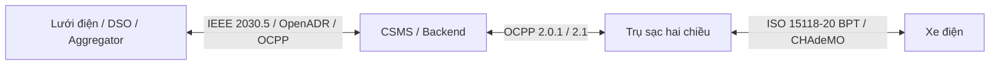

# 5. V2G (Vehicle-to-Grid)

- [Tổng quan V2X](tong-quan.md): V2L, V2H, V2B, V2G và các dịch vụ lưới
- [AC vs DC V2G](ac-dc.md): đặt bộ biến đổi ở đâu và hệ quả về chứng nhận
- [Chuẩn giao tiếp V2G](chuan-giao-tiep.md): ISO 15118-20, CHAdeMO, OCPP 2.1, IEEE 2030.5…

