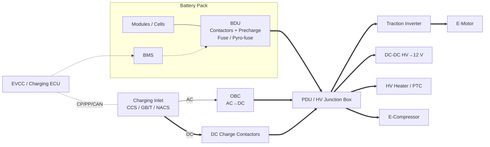

# Kiến trúc HV (HV Architecture)

## Sơ đồ khối (Block diagram)

**Đường DC (DC path):** dòng sạc DC đi thẳng từ inlet qua *DC charge contactors* vào thanh cái HV, không đi qua OBC.
**Đường AC (AC path):** điện AC từ inlet vào OBC, OBC chỉnh lưu và điều khiển dòng nạp vào pin.

## Thành phần chính (Main components)

| Thành phần | Tiếng Anh | Chức năng |
|---|---|---|
| Pack pin | Battery pack | Lưu trữ năng lượng; gồm cell, module, hệ làm mát |
| BMS | Battery Management System | Đo áp/dòng/nhiệt, tính SOC/SOH, cân bằng cell, ra giới hạn sạc/xả |
| BDU | Battery Disconnect Unit | Contactor chính (+/−), precharge, cầu chì, cảm biến dòng |
| PDU | Power Distribution Unit / Junction box | Phân phối HV tới các tải, cầu chì nhánh |
| Inverter | Traction inverter | DC→AC 3 pha cho động cơ; hồi sinh năng lượng |
| OBC | On-Board Charger | Sạc AC (thường 6,6 – 22 kW) |
| DC-DC | DC-DC converter / APM | HV → 12 V (hoặc 48 V) cấp cho hệ thống LV |
| EVCC | EV Communication Controller | Giao tiếp với trụ sạc (PLC hoặc CAN), điều phối phiên sạc |
| Inlet | Charging inlet / socket | Cổng sạc; có cảm biến nhiệt độ chân, khóa súng (*actuator lock*) |

## Nền tảng 400 V và 800 V (400 V vs 800 V platforms)

| Tiêu chí | 400 V | 800 V |
|---|---|---|
| Dải điện áp pack điển hình | ~250 – 470 V | ~550 – 920 V |
| Dòng cho cùng công suất | Cao | Thấp hơn khoảng 1/2 |
| Sạc DC công suất cao | Bị giới hạn bởi dòng súng (thường 200 – 500 A) | 270 – 350 kW+ với dòng vừa phải |
| Tương thích trụ 500 V cũ | Trực tiếp | Cần **boost** (DC-DC riêng, hoặc dùng cuộn dây động cơ + inverter làm boost) hoặc chuyển mạch pack 2×400 V |
| Linh kiện | Phổ biến, rẻ | Cần linh kiện 1200 V (thường SiC MOSFET), khoảng cách cách điện lớn hơn |

!!! tip "Công suất – điện áp – dòng"
    \( P = U \times I \). Ví dụ: 350 kW ở 800 V cần ~438 A; ở 400 V cần ~875 A (vượt khả năng hầu hết súng sạc).

## Tương tác HV khi sạc DC (HV interaction during DC charging)

1. BMS cung cấp giới hạn: điện áp tối đa, dòng tối đa, SOC, nhiệt độ.
2. EVCC chuyển các giới hạn này thành bản tin gửi trụ (*EVMaximumVoltage*, *EVTargetCurrent*, hoặc BCP/BCL ở GB/T).
3. Trụ kiểm tra cách điện trên cáp, nạp trước (*pre-charge*) đến điện áp pack.
4. Xe đóng *DC charge contactors* khi chênh áp nhỏ.
5. BMS cập nhật dòng yêu cầu liên tục theo nhiệt độ và SOC (*charging curve / derating*).
