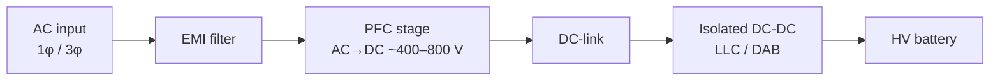

# OBC & DC-DC

## Bộ sạc trên xe (On-Board Charger, OBC)

### Cấu trúc (Topology)

- **PFC** (*Power Factor Correction*): chỉnh lưu và giữ hệ số công suất gần 1, dòng gần hình sin.
- **DC-DC cách ly:** LLC cộng hưởng (một chiều) hoặc **DAB** (*Dual Active Bridge*, hai chiều – dùng cho V2L/V2H/V2G AC).

### Công suất điển hình (Typical ratings)

| Nguồn AC | Dòng | Công suất |
|---|---|---|
| 1 pha 230 V | 16 A | ~3,7 kW |
| 1 pha 230 V | 32 A | ~7,4 kW |
| 1 pha 240 V (Bắc Mỹ, split-phase) | 32 A / 48 A | ~7,7 / 11,5 kW |
| 3 pha 400 V | 16 A | ~11 kW |
| 3 pha 400 V | 32 A | ~22 kW |

OBC điều chỉnh dòng AC sao cho **không vượt** giá trị lớn nhất mà trụ báo qua CP (duty cycle) và cáp cho phép qua PP.

## Bộ chuyển đổi DC-DC (HV→LV)

- Cấp nguồn 12 V (hoặc 48 V) và sạc ắc quy LV, thay cho máy phát trên xe xăng.
- Công suất điển hình 1,5 – 3,5 kW.
- **Khi sạc:** DC-DC phải chạy để duy trì nguồn cho BMS, EVCC, bơm làm mát… Phiên sạc kéo dài có thể bị gián đoạn nếu DC-DC lỗi và ắc quy 12 V tụt áp.

!!! tip "Lỗi kinh điển"
    Ắc quy 12 V yếu → EVCC/BMS reset giữa phiên sạc → phiên sạc bị ngắt không rõ lý do. Luôn kiểm tra điện áp LV khi chẩn đoán lỗi sạc.
