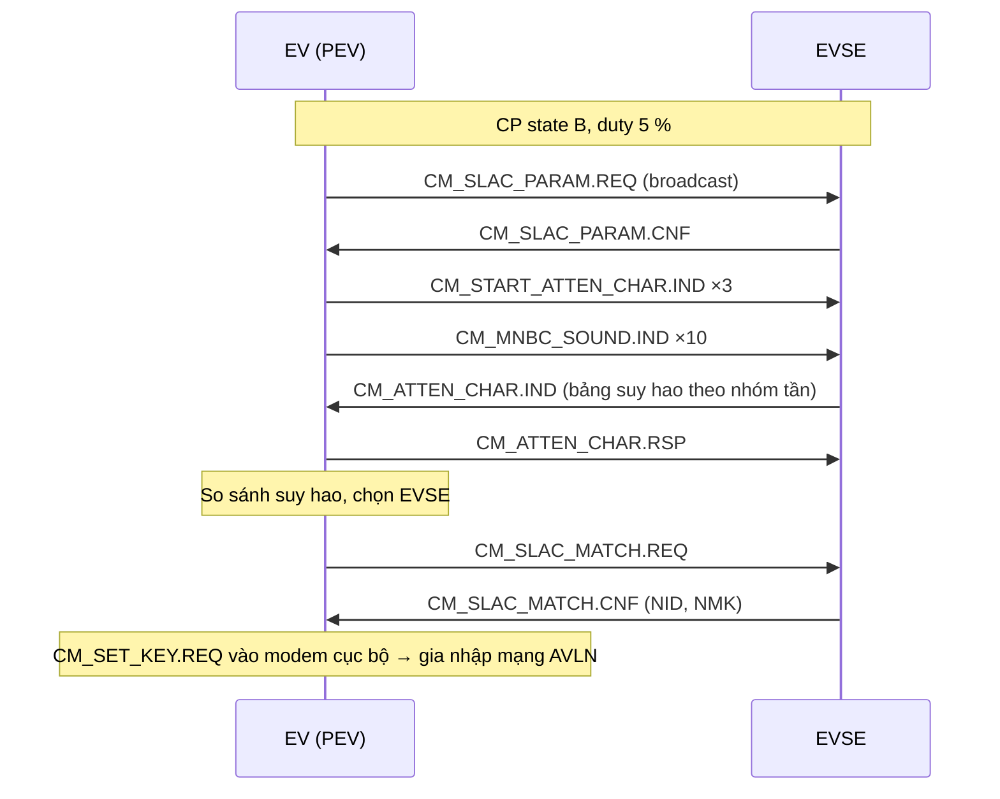

# PLC & SLAC

## HomePlug Green PHY

- Truyền thông qua đường dây trên cặp **CP–PE**, chồng lên tín hiệu PWM 1 kHz.
- Băng tần ~2 – 30 MHz, điều chế **OFDM**, chỉ dùng chế độ **ROBO** (bền vững), tốc độ tối đa ~10 Mbit/s.
- Ghép tín hiệu bằng tụ / biến áp; modem phổ biến: Qualcomm QCA7000/7005, Vertexcom, Lumissil…
- Mỗi phía có một modem PLC; khi cắm, cần xác định **đúng cặp** trụ–xe vì nhiễu xuyên âm (*crosstalk*) giữa các cáp trong trạm nhiều trụ.

## SLAC – ghép cặp (ISO 15118-3)

**SLAC** (*Signal Level Attenuation Characterization*): xe đo mức suy hao tín hiệu từ các trụ "nghe thấy" mình và chọn trụ có suy hao thấp nhất (tức trụ đang nối dây trực tiếp).

### Lưu ý (Notes)

- Xe khởi động SLAC sau khi nhận biết CP state B và 5 % (hoặc theo tùy chọn HLC trên AC).
- Có giới hạn thời gian cho toàn bộ quá trình (cỡ hàng chục giây kể từ khi cắm); nếu thất bại, xe có thể thử lại hoặc trụ chuyển CP sang trạng thái lỗi/khởi động lại.
- Ngưỡng suy hao điển hình xe chấp nhận: vài chục dB; suy hao quá lớn → nghi ngờ cáp, tiếp địa PE kém hoặc mạch ghép PLC hỏng.

## SDP – tìm SECC (SECC Discovery Protocol)

1. Sau khi gia nhập mạng PLC, xe cấu hình địa chỉ **IPv6 link-local**.
2. Xe gửi **SECCDiscoveryReq** qua **UDP multicast** tới `FF02::1`, cổng **15118**:
    - *Security:* `0x00` = TLS, `0x10` = không TLS
    - *Transport protocol:* `0x00` = TCP
3. Trụ trả **SECCDiscoveryRes**: địa chỉ IPv6 + cổng TCP + lựa chọn bảo mật.
4. Xe mở kết nối TCP (và TLS nếu có).

## V2GTP header

| Byte | Trường | Giá trị |
|---|---|---|
| 0 | Protocol version | `0x01` |
| 1 | Inverse version | `0xFE` |
| 2–3 | Payload type | `0x8001` = EXI; `0x9000` = SDP Req; `0x9001` = SDP Res |
| 4–7 | Payload length | Độ dài payload (byte) |

## Bản tin đầu tiên: SupportedAppProtocol

Xe gửi danh sách giao thức hỗ trợ theo thứ tự ưu tiên, ví dụ:

| Namespace | Giao thức |
|---|---|
| `urn:din:70121:2012:MsgDef` | DIN SPEC 70121 |
| `urn:iso:15118:2:2013:MsgDef` | ISO 15118-2 |
| `urn:iso:std:iso:15118:-20:DC` | ISO 15118-20 DC |
| `urn:iso:std:iso:15118:-20:AC` | ISO 15118-20 AC |

Trụ chọn một giao thức và trả *SchemaID*. Từ đây phiên sạc chạy theo giao thức đã chọn.
