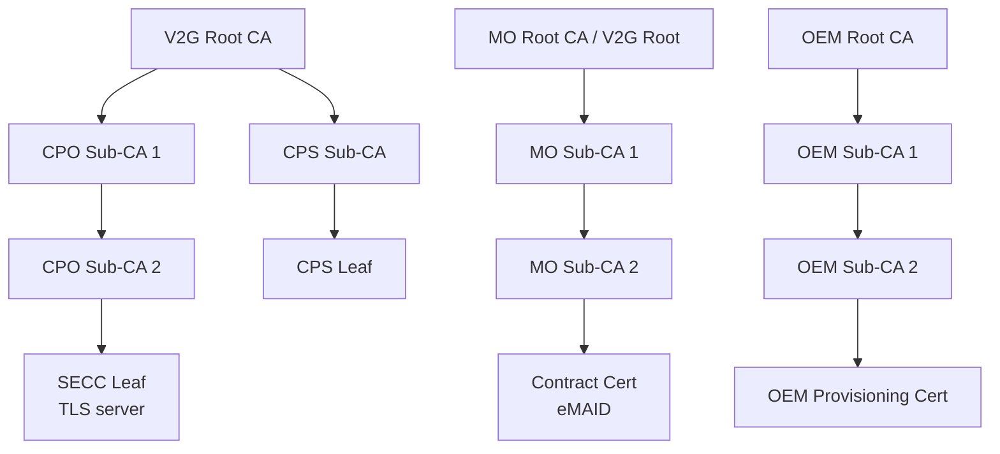

# Plug & Charge (PKI)

**Plug & Charge (PnC):** cắm súng là sạc, không cần thẻ/app. Xe xác thực hợp đồng bằng chứng chỉ số theo ISO 15118-2/-20.

## Các vai trò (Roles)

| Vai trò | Tiếng Anh | Chứng chỉ |
|---|---|---|
| Nhà vận hành trạm | CPO (*Charge Point Operator*) | Chứng chỉ SECC (TLS server) |
| Nhà cung cấp dịch vụ | MO / eMSP (*Mobility Operator*) | **Contract certificate** (gắn với eMAID) |
| Hãng xe | OEM | **OEM provisioning certificate** (định danh xe khi cài contract) |
| Gốc tin cậy | V2G Root CA | Chứng chỉ gốc ký các sub-CA của CPO (và thường cả MO/OEM) |
| Dịch vụ cấp phát | CPS (*Certificate Provisioning Service*) | Ký gói cài đặt contract certificate |

## Cây chứng chỉ (Certificate hierarchy)

## Luồng cài đặt hợp đồng (Contract installation)

1. Xe trình **OEM provisioning certificate** qua *CertificateInstallationReq*.
2. Trụ chuyển yêu cầu lên backend (qua OCPP 2.0.1 / 1.6 PnC extension) → **Contract Certificate Pool**.
3. Backend trả gói chứng chỉ contract đã mã hóa bằng khóa xe.
4. Xe lưu contract certificate + khóa riêng; những lần sau dùng *PaymentDetails* + *Authorization*.

## Lưu ý kỹ thuật (Engineering notes)

- **Thời gian hệ thống:** xác minh chứng chỉ cần đồng hồ đúng; xe có RTC sai → TLS thất bại.
- **Kho gốc tin cậy (root store):** xe phải chứa các V2G Root CA của các hệ sinh thái mục tiêu (nhiều PKI cùng tồn tại tại EU và Bắc Mỹ).
- **Hết hạn & thu hồi:** kiểm tra ngày hết hạn, OCSP; quy trình cập nhật (*CertificateUpdate*).
- **Khóa riêng:** lưu trong phần cứng an toàn (HSM / Secure Element) nếu có thể.
- **ISO 15118-20:** TLS 1.3 bắt buộc, có thể có *vehicle certificate* cho mutual TLS.
