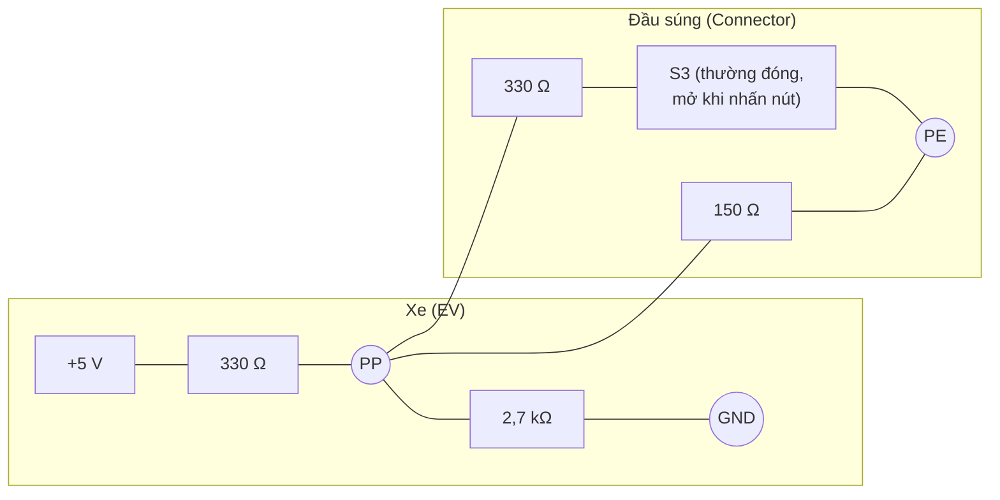

# Proximity Pilot (PP)

PP cho biết **súng đã được cắm** và (với Type 2) **dòng định mức của cáp**. Mạch khác nhau giữa Type 2 (IEC) và Type 1 (SAE J1772).

## Type 2 / CCS2 AC – mã hóa bằng điện trở (IEC 62196-2, IEC 61851-1 Annex B)

Điện trở \(R_C\) nằm trong đầu cắm, nối giữa PP và PE:

| \(R_C\) | Dòng định mức cáp |
|---|---|
| 1,5 kΩ | 13 A |
| 680 Ω | 20 A |
| 220 Ω | 32 A |
| 100 Ω | 63 A (3 pha) / 70 A (1 pha) |

Dòng sạc thực tế = **min**(dòng CP báo, dòng cáp theo PP, giới hạn OBC, giới hạn xe).

!!! note "Một số triển khai dùng thêm công tắc"
    Một số đầu cắm có công tắc nối tiếp hoặc song song để báo nút nhả khóa được nhấn; xe đọc thay đổi điện trở để giảm dòng trước khi súng bị rút.

## Type 1 / CCS1 / J1772 – mạch có công tắc chốt (latch switch S3)

| Tình trạng | Trở kháng súng | Điện áp PP đo ở xe (xấp xỉ) |
|---|---|---|
| Chưa cắm | ∞ | ~4,5 V |
| Cắm, đã chốt (S3 đóng) | 150 Ω | ~1,5 V |
| Cắm, đang nhấn nút (S3 mở) | 150 + 330 = 480 Ω | ~2,8 – 3,0 V |

Khi phát hiện nút được nhấn, xe phải **giảm dòng về 0** trước khi tiếp điểm tách ra.

## GB/T – CC (Connection Confirmation)

GB/T dùng tín hiệu **CC** thay cho PP. Với AC, điện trở \(R_C\) trong đầu cắm cũng mã hóa dòng cáp (giá trị tương tự IEC). Với DC, có hai tín hiệu **CC1** (trụ đọc) và **CC2** (xe đọc). Xem [GB/T](../chuan/gbt.md).

## Đầu DC (CCS1, CCS2, NACS)

Trên súng DC, PP chủ yếu dùng để **phát hiện kết nối và trạng thái chốt**; dòng DC được thỏa thuận qua giao tiếp số, không qua điện trở PP.
